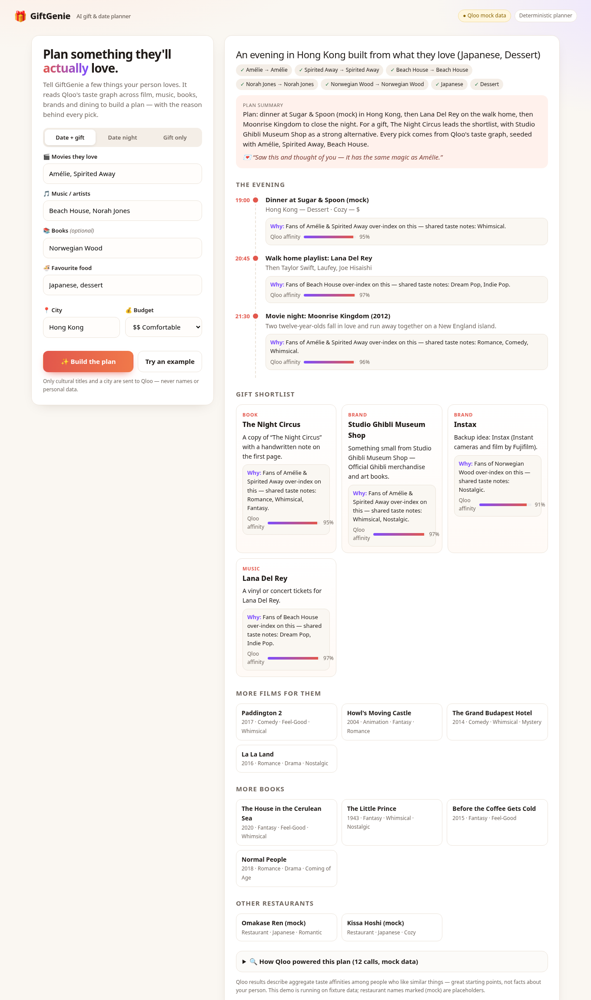

# 🎁 GiftGenie — AI Gift & Date Planner

> Built for the [Qloo Agentic Hackathon](https://qloo.devpost.com). MIT licensed.

**Problem.** "What should I get them?" and "Where should we go?" are hard because taste is
cross-domain: knowing someone loves *Amélie* and Beach House doesn't tell you which restaurant,
book or brand they'll love. Generic LLMs guess; GiftGenie asks Qloo's taste graph.

**What it does.** You enter a few things your partner or friend loves (movies, music, books, food)
and a city. The GiftGenie agent:

1. **Resolves** each title to a Qloo entity (`/search`) and shows you the matches.
2. **Maps** food words to Qloo restaurant genre tags (`/v2/tags`).
3. **Asks Qloo for cross-domain affinities** (`/v2/insights`) using the resolved entities as the
   taste signal: restaurants in the city (filtered by cuisine), films, artists, books and brands.
4. **Builds a plan**: an evening timeline (dinner → playlist → movie night) and a gift shortlist,
   each pick with *why* (shared taste notes with the things they love + Qloo affinity score).
5. Optionally lets an **LLM** polish the summary and gift-card message — it may only use Qloo's picks.

Without Qloo there is no plan: every recommendation, every reason and every score comes from Qloo results.
The UI shows a full log of every Qloo request ("How Qloo powered this plan").



## Run locally

Requires Node.js 20+. No dependencies to install.

```sh
cp .env.example .env     # optional
npm start                # http://localhost:3000
# open http://localhost:3000/?demo=1 for a pre-filled example
npm run smoke            # end-to-end test in mock mode
```

| Env var | Purpose |
| --- | --- |
| `QLOO_API_KEY` | Qloo event key. **Empty = mock mode** (offline fixture data shaped like real responses). |
| `QLOO_BASE_URL` | Defaults to `https://hackathon.api.qloo.com`. Hackathon keys return 401 against `https://api.qloo.com`. Set this to use a different host. |
| `QLOO_MOCK=1` | Force mock mode even when a key is set. |
| `LLM_API_KEY` | Optional. Any OpenAI-compatible Chat Completions API (default OpenAI `gpt-4o-mini`). Empty = deterministic planner. |
| `LLM_BASE_URL`, `LLM_MODEL` | Point at another OpenAI-compatible provider. |

The key is used only on the server (`X-Api-Key` header) and is never sent to the browser.

## Qloo request → result (redacted)

```
GET /search?query=Amélie&types=urn:entity:movie&take=1           → Amélie (entity_id …)
GET /v2/tags?filter.query=Japanese&filter.tag.types=urn:tag:genre:place:restaurant&take=1
                                                                 → urn:tag:genre:place:restaurant:japanese
GET /v2/insights?filter.type=urn:entity:place
    &filter.tags=urn:tag:category:place:restaurant,urn:tag:genre:place:restaurant:japanese
    &filter.location.query=Hong Kong
    &signal.interests.entities=<amélie>,<spirited away>,<beach house>&take=5
                                                                 → ranked restaurants with query.affinity
GET /v2/insights?filter.type=urn:entity:{movie|artist|book|brand}&signal.interests.entities=…&take=5
```

About 10–12 Qloo calls per plan; identical requests are cached in memory, 429s get one bounded retry,
and the public endpoint is rate-limited per IP to protect the event quota.

## Architecture

```
public/        static UI (vanilla HTML/CSS/JS)
server.js      zero-dependency Node HTTP server: /api/plan, /api/status
lib/qloo.js    live Qloo client (+ mock switch)
lib/mock.js    offline Qloo with realistic fixtures (lib/fixtures.js)
lib/agent.js   resolve → tags → insights → plan + reasons + provenance trace
lib/llm.js     optional LLM narrative, deterministic fallback
```

## Responsible use & limitations

- Only public cultural titles and a city go to Qloo — never names, emails or other personal data.
- Qloo results are **aggregate affinities** ("fans of X over-index on Y"), not facts about one person.
  The UI says so and distinguishes Qloo results from GiftGenie's own interpretation (plan structure, gift wording).
- Entity resolution takes Qloo's top search match; check the ✓ chips — an ambiguous title can change the result.
- Mock mode uses fixture data; restaurants marked "(mock)" are placeholders.

## Deploy

Any Node host works (e.g. Render free web service: build command *none*, start `npm start`,
set `QLOO_API_KEY` as a secret). Vercel would need the API moved to a serverless function.

## License

[MIT](LICENSE)
